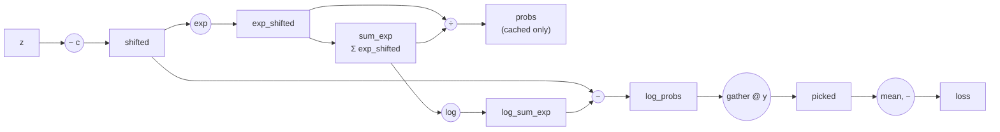

# From a neuron to an MLP

The [first post](01-autograd.md) built an engine that can differentiate any
composition of ops. This one uses it to build the smallest thing that
deserves the name neural network: linear layers, a nonlinearity between
them, a loss on top — and the bookkeeping (`Module`) that makes the
parameters findable.

## `Module`: finding the parameters

An optimizer needs a flat list of every trainable tensor in a model.
[`nn/module.py`](https://github.com/maaaax1611/nabla/blob/main/src/nabla/nn/module.py) gets it without any
registration step, by looking at the instance's own attributes:

```python
def parameters(self) -> list[Tensor]:
    params = []
    for value in self.__dict__.values():
        if isinstance(value, Tensor) and value.requires_grad:
            params.append(value)
        elif isinstance(value, Module):
            params.extend(value.parameters())
    return params
```

Assign a `Tensor` with `requires_grad=True` or another `Module` to `self`
and it is found, recursively. The same walk powers `train()` / `eval()`,
`to(device)`, `zero_grad()` and `state_dict()`. The one thing it cannot see
is a module hidden inside a plain Python list — that gap is what
[`ModuleList`](05-transformer.md#modulelist) closes later.

## The linear layer

$$
y = xW + b, \qquad x \in \mathbb{R}^{N \times d_\text{in}},\;
W \in \mathbb{R}^{d_\text{in} \times d_\text{out}},\;
b \in \mathbb{R}^{d_\text{out}}
$$

nabla stores $W$ as `(in_features, out_features)` and multiplies from the
right, so a batch of row vectors goes in and a batch of row vectors comes
out. The whole layer is one line
([`nn/linear.py`](https://github.com/maaaax1611/nabla/blob/main/src/nabla/nn/linear.py)):

```python
return x.matmul(self.weight) + self.bias
```

There is no `Linear.backward`. The gradient comes from the two ops it is
made of. For $Y = XW$ and an upstream gradient $G = \partial L / \partial Y$:

$$
\frac{\partial L}{\partial W} = X^\top G, \qquad
\frac{\partial L}{\partial X} = G\,W^\top
$$

A quick way to remember these without deriving them index by index: the
result must have the shape of the thing you differentiate with respect to,
and there is only one way to multiply $G$ with the other factor that
produces that shape. That is exactly
[`MatMul.backward`](https://github.com/maaaax1611/nabla/blob/main/src/nabla/ops/transform.py):

```python
grad_a = xp.matmul(grad_output, xp.swapaxes(b.data, -1, -2))
grad_b = xp.matmul(xp.swapaxes(a.data, -1, -2), grad_output)
```

The bias is added by broadcasting `(d_out,)` against `(N, d_out)`, so its
gradient is the upstream gradient summed over the batch axis — the
`unbroadcast` helper from the [first post](01-autograd.md).

## Why a nonlinearity

Stack two linear layers without anything in between and you get
$(xW_1 + b_1)W_2 + b_2 = x(W_1W_2) + (b_1W_2 + b_2)$ — still one linear
layer, just with more parameters. Depth only buys expressive power if
something nonlinear sits between the layers.

| Activation | $f(x)$ | $f'(x)$ | Notes |
| --- | --- | --- | --- |
| ReLU | $\max(0, x)$ | $1$ if $x > 0$, else $0$ | cheap, gradient never shrinks on the active side |
| Sigmoid | $\frac{1}{1+e^{-x}}$ | $f(x)\,(1 - f(x))$ | at most $0.25$, saturates on both sides |
| Tanh | $\tanh x$ | $1 - f(x)^2$ | zero-centred sigmoid, still saturates |
| GELU | $x\,\Phi(x)$ | see below | smooth ReLU, the Transformer default |

Sigmoid and tanh have derivatives that can be written in terms of their own
output, so their `Function`s save the output and never touch the input
again ([`ops/activation.py`](https://github.com/maaaax1611/nabla/blob/main/src/nabla/ops/activation.py)).

**GELU** weights its input by the Gaussian CDF $\Phi(x)$. NumPy has no
`erf`, so nabla uses the tanh approximation that GPT-2 and BERT use:

$$
\text{gelu}(x) \approx \tfrac{1}{2}\,x\,\bigl(1 + \tanh u\bigr), \qquad
u = \sqrt{2/\pi}\,\bigl(x + 0.044715\,x^3\bigr)
$$

Its derivative is the product rule plus the tanh derivative from the table:

$$
\frac{d}{dx}\,\text{gelu}(x) = \tfrac{1}{2}(1 + \tanh u)
+ \tfrac{1}{2}\,x\,(1 - \tanh^2 u)\,\sqrt{2/\pi}\,\bigl(1 + 3 \cdot 0.044715\,x^2\bigr)
$$

## Initialization

If the weights start too small, the signal shrinks layer by layer until
nothing reaches the output; too large and it explodes. The goal of an
initialization scheme is to keep the variance of the activations roughly
constant from layer to layer ([`init.py`](https://github.com/maaaax1611/nabla/blob/main/src/nabla/init.py)).

For a layer with $n_\text{in}$ inputs and weights of variance $\sigma^2$,
each output is a sum of $n_\text{in}$ terms, so its variance is about
$n_\text{in}\,\sigma^2$ times the input variance. Keeping that factor at 1
gives $\sigma^2 = 1/n_\text{in}$.

- **Xavier / Glorot** averages the forward and the backward requirement:
  $\sigma^2 = 2 / (n_\text{in} + n_\text{out})$. nabla draws from a uniform
  distribution with the matching limit $\sqrt{6 / (n_\text{in} + n_\text{out})}$.
  Suited to tanh and sigmoid.
- **He / Kaiming** accounts for ReLU zeroing half of its inputs, which
  halves the variance: $\sigma^2 = 2 / n_\text{in}$. This is the default
  for `Linear` and `Conv2D`.

For a convolution, "fan-in" is the number of inputs that feed one output
value: `in_channels * kh * kw`.

## Mean squared error

The simplest loss, and another one that needs no `Function` of its own
([`nn/loss.py`](https://github.com/maaaax1611/nabla/blob/main/src/nabla/nn/loss.py)):

```python
diff = predictions - targets
return (diff * diff).mean()
```

`Subtract`, `Multiply` and `Mean` already exist, so the gradient
$\frac{2}{n}(\hat{y} - y)$ falls out of the graph.

## Softmax + Cross-Entropy


For multi-class classification, a network outputs one raw score
("logit") per class, and we need two things: a way to turn those scores
into a probability distribution (**softmax**), and a way to measure how far
that distribution is from the true label (**cross-entropy**). nabla
implements both together as a single `Function`,
[`SoftmaxCrossEntropy`](https://github.com/maaaax1611/nabla/blob/main/src/nabla/ops/loss.py) — not because they can't
be expressed as separate ops, but because fusing them is both more
numerically stable *and* produces a dramatically simpler gradient. Both
reasons are worth spelling out.

### Softmax

For logits $z \in \mathbb{R}^K$ ($K$ classes):

$$
\text{softmax}(z)_k = \frac{e^{z_k}}{\sum_{j=1}^K e^{z_j}}
$$

This is a genuine problem to compute directly: if any logit is large (say
$z_k = 1000$), $e^{z_k}$ overflows a float64 long before it matters. The
fix is the **log-sum-exp trick** — softmax is invariant to subtracting any
constant $c$ from every logit (it cancels in the ratio), so subtracting the
row's max keeps every exponent $\le 0$:

$$
\text{softmax}(z)_k = \frac{e^{z_k - c}}{\sum_j e^{z_j - c}}, \qquad c = \max_j z_j
$$

```python
shifted = logits.data - logits.data.max(axis=1, keepdims=True)
exp_shifted = np.exp(shifted)
probs = exp_shifted / exp_shifted.sum(axis=1, keepdims=True)
```

### Cross-entropy

Given the true class index $y$ (an integer, not a `Tensor` in a
differentiable sense — see the note at the end), cross-entropy is just the
negative log-probability the model assigned to the correct class, averaged
over the batch:

$$
L = -\frac{1}{B}\sum_{n=1}^{B} \log \text{softmax}(z^{(n)})_{y^{(n)}}
$$

Computing $\log(\text{softmax}(z)_k)$ directly from `probs` would first
compute a (possibly tiny) probability and then take its log — losing
precision for exactly the confident, correct predictions you care about
getting right at the end of training. Since `shifted` and
`log(sum_exp)` are already on hand from the softmax computation above,
`log_probs` is computed directly instead:

$$
\log \text{softmax}(z)_k = (z_k - c) - \log \sum_j e^{z_j - c}
$$

```python
log_probs = shifted - np.log(sum_exp)
picked = log_probs[np.arange(batch_size), target_idx]
loss = -picked.mean()
```

### The gradient: why fusing the two ops pays off

Drawn as a graph the way
[BatchNorm2D's](04-cnn.md#backward-derived-from-the-computational-graph)
and [LayerNorm's](05-transformer.md#backward-same-graph-different-axis)
backward passes are, forward looks like this (the `probs` branch is cached
for backward but isn't on the path `loss` actually depends on — the code
computes `log_probs` straight from `shifted`, for the precision reason
above):



Unlike BatchNorm2D/LayerNorm, nabla's backward here does **not** walk this
graph node by node — and there's a good reason not to. Every element of
`exp_shifted` feeds into the *same* `sum_exp`, which then feeds into every
element of `log_probs` through `logNode`/`subLSE` — so gradient fans back
out from one target class to all $K$ classes at the `sumNode`/`logNode`
step. Handled generically, that fan-out *is* softmax's Jacobian, just
spread across graph edges instead of packed into one $K \times K$ matrix —
same cost, more code to get right.

Composed with cross-entropy specifically, that fan-out collapses
algebraically instead. Writing $p = \text{softmax}(z)$ (the `probs` node)
and $y$ as the one-hot vector of the true class:

1. Only the target class contributes to the loss at all
   ($L = -\log p_y$), so $\partial L/\partial p_y = -1/p_y$ and
   $\partial L/\partial p_k = 0$ for every $k \ne y$.
2. Softmax's own local Jacobian is
   $\partial p_k/\partial z_j = p_k(\delta_{kj} - p_j)$.
3. Chain rule sums over $k$, but step 1 already zeroed out every term
   except $k = y$:

$$
\frac{\partial L}{\partial z_j} = \frac{\partial L}{\partial p_y}\cdot\frac{\partial p_y}{\partial z_j}
= \left(-\frac{1}{p_y}\right) p_y(\delta_{yj} - p_j) = p_j - \delta_{yj} = p_j - y_j
$$

$$
\frac{\partial L}{\partial z_k} = p_k - y_k
$$

The result: the gradient w.r.t. the logits is just the predicted
distribution minus the target distribution — subtract 1 from the
probability of the true class, leave everything else untouched, done:

```python
grad_logits = self.probs.copy()
grad_logits[np.arange(self.batch_size), self.target_idx] -= 1
grad_logits *= grad_output / self.batch_size
```

This is one of the cleanest gradients in the whole library — a nice
illustration of how choosing *where* to draw the boundary between ops can
matter as much for the backward pass as for the forward one. A
[`tests/test_loss.py`](https://github.com/maaaax1611/nabla/blob/main/tests/test_loss.py) test checks exactly this
property directly: `grad_logits.sum(axis=1)` should be `0` for every row,
since both `probs` and the one-hot target sum to 1.

### `targets` isn't differentiable

`targets` (the integer class labels) is still passed through `Function.apply`
as a `Tensor` — mainly so it participates in the graph machinery the same
way every other input does — but it's never meaningful to differentiate
with respect to a class index. `backward` returns a zero array for it, and
since `CrossEntropyLoss` (the [`nn/loss.py`](https://github.com/maaaax1611/nabla/blob/main/src/nabla/nn/loss.py)
wrapper) never sets `requires_grad=True` on it, that gradient is computed
but immediately discarded by `Tensor.backward()`'s
`if parent.requires_grad:` check (see
[Autodiff basics](01-autograd.md#the-chain-rule-as-a-topological-sort)).

## Softmax


[`ops/loss.py`](https://github.com/maaaax1611/nabla/blob/main/src/nabla/ops/loss.py) already computes softmax
internally, fused with cross-entropy — but that fusion only works when a
cross-entropy loss is the very next thing downstream. Once you want softmax
somewhere *else* (most immediately: turning attention scores into weights
for a Transformer), it needs to be its own differentiable
[`Function`](https://github.com/maaaax1611/nabla/blob/main/src/nabla/ops/softmax.py), unaware of whatever comes after
it.

That difference matters for the backward pass. `SoftmaxCrossEntropy`'s
gradient collapses all the way down to `probs - one_hot`
(see [Softmax + Cross-Entropy](#the-gradient-why-fusing-the-two-ops-pays-off))
precisely *because* it knows the very next op is a log + gather against a
one-hot target. A standalone `Softmax` has no such luck — it has to return
the correct gradient for *any* downstream computation, which means
implementing softmax's actual Jacobian-vector product, not a shortcut.

### Softmax: the math

For $x \in \mathbb{R}^K$ along the chosen axis:

$$
\text{softmax}(x)_k = \frac{e^{x_k}}{\sum_{j=1}^K e^{x_j}}
$$

computed the same numerically-stable way as everywhere else in nabla — the
log-sum-exp trick, subtracting the row's max before exponentiating so
`exp()` never overflows:

```python
shifted = x.data - x.data.max(axis=self.axis, keepdims=True)
exp_shifted = np.exp(shifted)
sum_exp = exp_shifted.sum(axis=self.axis, keepdims=True)
self.probs = exp_shifted / sum_exp
```

### Backward: the Jacobian-vector product

Softmax's defining trait is that **every output depends on every input**,
because they all divide by the same sum. Its local Jacobian is:

$$
\frac{\partial p_j}{\partial x_k} = p_j (\delta_{jk} - p_k)
\qquad\text{(} \delta_{jk}=1 \text{ if } j=k \text{, else } 0 \text{)}
$$

split into a diagonal term ($j=k$: $p_k(1-p_k)$) and an off-diagonal term
($j \ne k$: $-p_j p_k$). For a $K$-class row that's a full $K \times K$
matrix — never actually built in the code below, because the chain rule
collapses it to something far cheaper. Writing $g_j$ for the incoming
gradient (`grad_output` in code, i.e. the $j$-th component of
$\partial L/\partial p$):

$$
\frac{\partial L}{\partial x_k} = \sum_j \frac{\partial L}{\partial p_j}\cdot\frac{\partial p_j}{\partial x_k}
= \sum_j g_j \cdot p_j(\delta_{jk} - p_k)
$$

Split the sum at $\delta_{jk}$ — one term survives only at $j=k$, the other
has $p_k$ constant in $j$ and factors out:

$$
= \underbrace{g_k \cdot p_k}_{j=k \text{ term}} \;-\; \underbrace{p_k \sum_j g_j \cdot p_j}_{p_k \text{ factored out}}
$$

$$
\frac{\partial L}{\partial x_k} = p_k \left( g_k - \sum_j g_j \cdot p_j \right)
$$

`sum_j grad_output_j * p_j` is one scalar per row — the probability-weighted
average of the incoming gradient — subtracted from every element before
scaling by that element's own probability. Intuitively: nudging $x_k$
doesn't just move $p_k$, it also nudges every other $p_j$ slightly (they all
share the same normalizer), and that shared-normalizer term is exactly what
this correction accounts for.

```python
def backward(self, grad_output: NDArray) -> tuple[NDArray]:
    weighted_sum = np.sum(grad_output * self.probs, axis=self.axis, keepdims=True)
    return (self.probs * (grad_output - weighted_sum),)
```

### Softmax: implementation

[`ops/softmax.py`](https://github.com/maaaax1611/nabla/blob/main/src/nabla/ops/softmax.py) takes an `axis` argument
(default: the last axis) rather than hardcoding which axis gets normalized
— `Tensor.softmax(axis=-1)` needs that flexibility for attention, where
softmax is applied over the key/sequence axis, not necessarily the last one
depending on how scores are laid out.
[`tests/test_softmax_ops.py`](https://github.com/maaaax1611/nabla/blob/main/tests/test_softmax_ops.py) checks forward
against a naive reference, numerical stability on very large logits,
backward against a numerical gradient (including a non-default `axis`),
and one property specific to this gradient formula: if `grad_output` is
uniform, `sum_j grad_output_j * p_j` reduces to `grad_output` itself
(since `probs` sums to 1), so the correction term cancels `grad_output`
exactly and `x.grad` comes out as zero everywhere.

### `nn.Softmax` has no parameters or train/eval split

[`nn/softmax.py`](https://github.com/maaaax1611/nabla/blob/main/src/nabla/nn/softmax.py) is a thin `Module` wrapper
purely so softmax composes like any other layer inside a bigger model
(e.g. as one line in an attention block's `forward`) — it holds no
parameters and, like [LayerNorm](05-transformer.md#no-traineval-split),
behaves identically regardless of `self.training`.

## Example: XOR

XOR is the classic function a single linear layer cannot represent — no
straight line separates `(0,1), (1,0)` from `(0,0), (1,1)`. One hidden layer
is enough ([`examples/xor.py`](https://github.com/maaaax1611/nabla/blob/main/examples/xor.py)):

```python
class XORNet(Module):
    def __init__(self):
        super().__init__()
        self.fc1 = Linear(2, 8)
        self.fc2 = Linear(8, 1)

    def forward(self, x):
        return self.fc2(self.fc1(x).relu()).sigmoid()
```

The training loop is the four lines every later example repeats:

```python
pred = net(X)
loss = criterion(pred, y)

net.zero_grad()
loss.backward()
optimizer.step()
```

`zero_grad()` matters because `backward()` *accumulates* into `.grad` (that
is what makes shared weights work, see the
[first post](01-autograd.md)). Skip it and every step adds its gradient on
top of all previous ones.

```bash
uv run python examples/xor.py
```

What `optimizer.step()` actually does is the subject of the
[next post](03-training.md).

---

Previous: [Autograd from scratch](01-autograd.md) · Next: [Training: optimizers, regularization, schedules](03-training.md)
