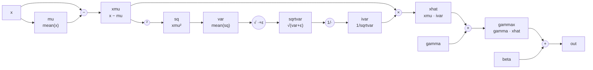

# Convolutional networks

A fully connected layer treats an image as a flat list of numbers and has to
learn from scratch that neighbouring pixels belong together. A convolution
builds that assumption in: the same small filter is applied at every
position. This post covers the three ops a classic CNN is made of —
convolution, pooling and batch normalization — and derives each backward
pass.

## Conv2D


A 2D convolution slides a small kernel over an image and, at every
position, computes a dot product between the kernel and the patch of the
image underneath it. Stacking multiple kernels (`out_channels` of them)
gives multiple output feature maps at once.

Strictly speaking, what deep learning frameworks call "convolution" is
*cross-correlation* (the kernel is not flipped before sliding it across the
input) — nabla follows that same convention, since it makes no practical
difference for a kernel whose weights are learned anyway.

### Conv2D: the math

For input $x$ of shape `(batch, in_channels, H, W)`, weight $w$ of shape
`(out_channels, in_channels, kh, kw)` and bias $b$ of shape
`(out_channels,)`:

$$
\text{out}[n, o, i, j] = b[o] + \sum_{c=1}^{C} \sum_{p=1}^{kh} \sum_{q=1}^{kw} x[n, c, i \cdot s + p,\ j \cdot s + q] \cdot w[o, c, p, q]
$$

where $s$ is the stride, and the output spatial size is

$$
\text{out}_h = \left\lfloor \frac{H + 2 \cdot \text{padding} - kh}{s} \right\rfloor + 1 \qquad (\text{analogous for } \text{out}_w)
$$

### im2col: turning convolution into one matrix multiply

Computing that triple sum with Python loops over every output position
would be slow. The standard trick — **im2col** ("image to columns") — turns
the whole convolution into a single matrix multiply instead:

1. For every output position `(i, j)`, extract the `(in_channels, kh, kw)`
   patch of the input that the kernel would slide over there.
2. Flatten each patch into a column of length `in_channels * kh * kw`.
   Stack all `batch * out_h * out_w` of these columns side by side into a
   matrix `cols` of shape `(in_channels*kh*kw, batch*out_h*out_w)`.
3. Flatten the weight into `(out_channels, in_channels*kh*kw)`.
4. The whole convolution is now one matmul: `weight_flat @ cols`, shape
   `(out_channels, batch*out_h*out_w)`.
5. Reshape that back into `(batch, out_channels, out_h, out_w)`.

### Conv2D: implementation walkthrough

[`ops/conv.py`](https://github.com/maaaax1611/nabla/blob/main/src/nabla/ops/conv.py) implements exactly those five
steps:

```python
windows = sliding_window_view(self.x_padded, (kh, kw), axis=(2, 3))
windows = windows[:, :, ::self.stride, ::self.stride, :, :]
self.cols = windows.transpose(1, 4, 5, 0, 2, 3).reshape(in_channels * kh * kw, -1)
```

`sliding_window_view` is what makes step 1 fast: instead of copying every
patch, it returns a *view* over the original array with an extra `(kh, kw)`
window dimension — no data is duplicated, NumPy just computes different
strides into the same memory. Padding is applied once upfront
(`np.pad`) so the padded region can be sliced like any other pixel.

```python
weight_flat = weight.data.reshape(weight.data.shape[0], -1)
out_flat = weight_flat @ self.cols + bias.data.reshape(-1, 1)
out = out_flat.reshape(weight.data.shape[0], self.batch_size, self.out_h, self.out_w)
return out.transpose(1, 0, 2, 3)
```

> **Bug we hit:** the last line looks like it should be equivalent to
> `out_flat.reshape(batch_size, out_channels, out_h, out_w)` directly — it
> is not. `reshape` only *reinterprets* the existing flat memory layout; it
> has no idea which axis is "supposed to" move where. `out_flat`'s memory is
> laid out as `(out_channels, batch*out_h*out_w)`, so reshaping straight
> into `(batch, out_channels, out_h, out_w)` silently scrambles values
> whenever `batch > 1` *and* `out_channels > 1` (with either one equal to 1
> the bug is invisible, which is exactly how it slipped through at first).
> The fix is to reshape into the shape that matches the *current* memory
> order first (`(out_channels, batch, out_h, out_w)`), and only then
> `transpose` — transpose actually reorders axes, reshape does not.

### Conv2D: backward

Because forward is just "reshape → matmul → reshape", backward is the same
matmul-based reasoning in reverse, computed once `cols` and `weight_flat`
are around from forward:

- **`grad_bias`**: the bias was simply added to every output position, so
  its gradient is the sum of `grad_output` over every axis except
  `out_channels`: `sum(grad_output, axis=(0, 2, 3))`.
- **`grad_weight`**: `weight_flat @ cols` is a plain matmul, so
  `grad_weight_flat = grad_output_flat @ cols.T` (standard matmul backward,
  see [Autodiff basics](01-autograd.md#autodiff-basics) — `MatMul.backward` in
  [`ops/transform.py`](https://github.com/maaaax1611/nabla/blob/main/src/nabla/ops/transform.py) does the same thing).
- **`grad_x`**: first compute `grad_cols = weight_flat.T @ grad_output_flat`
  — the gradient w.r.t. the *extracted patches*. Then that has to be
  scattered back into the padded input at the same positions the patches
  were extracted from in forward, accumulating (`+=`) wherever windows
  overlapped (i.e. `stride < kernel_size`):

  ```python
  for i in range(self.out_h):
      for j in range(self.out_w):
          patch_grad = grad_cols[:, :, :, :, i, j].transpose(3, 0, 1, 2)
          h0, w0 = i * self.stride, j * self.stride
          grad_x_padded[:, :, h0:h0 + kh, w0:w0 + kw] += patch_grad
  ```

  Finally, the padding that was added in forward gets sliced back off.

All of this is checked against a hand-written triple-loop reference
implementation and against numerical (finite-difference) gradients in
[`tests/test_conv_ops.py`](https://github.com/maaaax1611/nabla/blob/main/tests/test_conv_ops.py).

## Pooling


Pooling shrinks a feature map spatially by summarizing each small window
with a single number — either its maximum or its average. Unlike
[Conv2D](#conv2d), there are no learnable weights: pooling is a fixed
function of its input, and it doesn't mix channels (each channel is pooled
independently).

Both `MaxPool2D` and `AvgPool2D`
([`ops/pooling.py`](https://github.com/maaaax1611/nabla/blob/main/src/nabla/ops/pooling.py)) share the same forward
skeleton — extract windows with `sliding_window_view`, take every
`stride`-th one, flatten the `(kh, kw)` window into one axis, and reduce
over it:

```python
windows = sliding_window_view(x.data, (kernel_size, kernel_size), axis=(2, 3))
windows = windows[:, :, ::stride, ::stride, :, :]
windows = windows.reshape(*windows.shape[:4], -1)  # (batch, channels, out_h, out_w, kh*kw)
```

Where they differ is the reduction — `np.max` vs. `np.mean` — and, much
more interestingly, in what that means for the gradient.

### Max pooling: the gradient is a router, not a formula

$$
\text{out}[n, c, i, j] = \max_{(p, q) \in \text{window}(i, j)} x[n, c, p, q]
$$

`max` is not smooth everywhere, but it *is* differentiable almost
everywhere, and where it is:

$$
\frac{\partial \, \text{out}[n,c,i,j]}{\partial \, x[n,c,p,q]} =
\begin{cases}
1 & \text{if } x[n,c,p,q] \text{ is the maximum in the window} \\
0 & \text{otherwise}
\end{cases}
$$

So the backward pass doesn't need any arithmetic on the incoming gradient —
it just needs to know *which* input position was the max for each output
position, and route the entire gradient there unchanged. `forward` records
exactly that with `np.argmax`:

```python
self.argmax = np.argmax(windows, axis=-1)  # (batch, channels, out_h, out_w)
```

and `backward` scatters `grad_output` back to those positions,
**accumulating** wherever overlapping windows (`stride < kernel_size`) route
gradient to the same input pixel more than once:

```python
for i in range(self.out_h):
    for j in range(self.out_w):
        di, dj = np.unravel_index(self.argmax[:, :, i, j], (kernel_size, kernel_size))
        h_idx, w_idx = i * stride + di, j * stride + dj
        np.add.at(grad_x, (batch_idx, channel_idx, h_idx, w_idx), grad_output[:, :, i, j])
```

> **Bug we hit:** the first version of this indexed with
> `grad_x[:, :, h_idx, w_idx]` — mixing plain slices (`:`) for the batch and
> channel axes with *array* indices (`h_idx`, `w_idx`, each shape
> `(batch, channels)`) for the spatial axes. NumPy's advanced-indexing rules
> don't broadcast that the way you'd hope: since the array indices aren't
> separated by a slice, they get inserted as their *own* dimensions at that
> position — the result ends up shaped `(batch, channels, batch, channels)`,
> effectively an outer product across every batch/channel pair instead of
> the intended one-to-one match per sample. The fix is to make the batch and
> channel axes into broadcastable arrays too
> (`np.arange(batch)[:, None]`, `np.arange(channels)[None, :]`), so *all
> four* index arrays broadcast together elementwise and each `(b, c)`
> position only ever touches its own `(h, w)`.

Note also what happens on ties: `np.argmax` always returns the *first*
occurrence of the maximum. That's an arbitrary but standard convention —
the subgradient of `max` is technically any convex combination of the tied
inputs, and frameworks universally just pick one.

### Average pooling: a genuinely linear op

$$
\text{out}[n, c, i, j] = \frac{1}{kh \cdot kw} \sum_{(p, q) \in \text{window}(i,j)} x[n, c, p, q]
$$

Average pooling is linear in $x$, so unlike max pooling its gradient
doesn't depend on the input values at all — every position in the window
contributed equally to the output, so every position gets an equal share of
the gradient back:

$$
\frac{\partial \, \text{out}[n,c,i,j]}{\partial \, x[n,c,p,q]} = \frac{1}{kh \cdot kw} \quad \text{for every } (p,q) \text{ in the window}
$$

which is exactly what `backward` does — no argmax bookkeeping needed, just
spread `grad_output / (kh*kw)` over the whole window (again accumulating on
overlap):

```python
grad_per_position = grad_output[:, :, i, j] / (kernel_size * kernel_size)
grad_x[:, :, h0:h0+kernel_size, w0:w0+kernel_size] += grad_per_position[:, :, None, None]
```

Both ops are checked against triple-loop reference implementations and
numerical gradients — including overlapping-window cases (`stride <
kernel_size`) — in
[`tests/test_pooling_ops.py`](https://github.com/maaaax1611/nabla/blob/main/tests/test_pooling_ops.py).

## BatchNorm2D


As a network trains, the distribution of activations flowing into each
layer keeps shifting (its inputs change every time the layers before it
update). Batch normalization re-centers and re-scales each channel's
activations to zero mean and unit variance *within the current batch*, then
lets the network learn its own preferred scale and shift back (`gamma`,
`beta`) on top of that. In practice this stabilizes and speeds up training
considerably.

nabla splits this into two layers, deliberately:

- **`ops/batchnorm.py`** ([`BatchNorm2D`](https://github.com/maaaax1611/nabla/blob/main/src/nabla/ops/batchnorm.py)) is
  the differentiable normalization *using the current batch's statistics*
  (training mode) — this section covers that.
- **`nn/batchnorm.py`**
  ([`BatchNorm2D`](https://github.com/maaaax1611/nabla/blob/main/src/nabla/nn/batchnorm.py)) is the `Module` wrapper:
  it holds `gamma`/`beta` as trainable parameters, calls the op above in
  training mode, tracks a running average of the batch statistics
  (`running_mean`, `running_var`), and switches to normalizing with *those*
  running statistics in eval mode — via ordinary `Tensor` arithmetic, not a
  second `Function` (see the note at the end).

### BatchNorm2D: the math

For input $x$ of shape `(batch, C, H, W)`, mean and variance are computed
**per channel**, over every other axis (`batch`, `H`, `W`) — so each of the
$C$ channels gets normalized independently, using $N = \text{batch} \cdot H
\cdot W$ values:

$$
\mu_c = \frac{1}{N}\sum x_c \qquad \sigma^2_c = \frac{1}{N}\sum (x_c - \mu_c)^2
$$

$$
\hat{x} = \frac{x - \mu}{\sqrt{\sigma^2 + \varepsilon}} \qquad \text{out} = \gamma \cdot \hat{x} + \beta
$$

($\varepsilon$ is a small constant purely to avoid dividing by zero.) Note
this uses the **biased** variance (divide by $N$, not $N{-}1$) — the same
convention PyTorch and every other framework uses for the normalization
itself.

### Backward, derived from the computational graph

This is the one op in nabla where the backward pass genuinely needs the
full chain rule, because $\mu$ and $\sigma^2$ are each themselves functions
of *every* element of $x$ — so $\partial L/\partial x$ has to account for
$x$'s effect on the output both directly (through $\hat x$) and indirectly
(through $\mu$ and $\sigma^2$). The cleanest way to see *why* that's true —
and to derive the gradient without having to trust a closed-form formula on
faith — is to stop treating `out = gamma * x_hat + beta` as one big
expression and instead break it into the atomic operations that actually
produce it, one node per operation:



Every arrow is one local, easy-to-differentiate operation (`−`, `²`, a
mean, `√`, `1/·`, `×`, `+`). `backward()` just walks this graph
right-to-left: at each node, multiply the gradient flowing in from the
right by that node's *local* derivative, and where an arrow forked into two
uses on the way forward (every value that feeds more than one downstream
node), the gradients flowing back **add up** at that fork. `x` is exactly
such a fork — it feeds `mu` *and* the subtraction directly — which is the
graph's way of showing the "direct vs. indirect path" mentioned above
before you even write a formula.

Walking backward from `out` (this is exactly [Kratzert's derivation for
batchnorm](https://kratzert.github.io/2016/02/12/understanding-the-gradient-flow-through-the-batch-normalization-layer.html),
adapted to nabla's per-channel axes):

| node | local derivative | gradient produced |
| --- | --- | --- |
| `addNode` (`out = gammax + beta`) | $\partial\text{out}/\partial\text{gammax}=1$, $\partial\text{out}/\partial\beta=1$ | `grad_gammax = grad_out`; `grad_beta = sum(grad_out)` over every axis except channels |
| `mulNode2` (`gammax = gamma · xhat`) | $\partial\text{gammax}/\partial\hat x=\gamma$, $\partial\text{gammax}/\partial\gamma=\hat x$ | `grad_xhat = grad_gammax * gamma`; `grad_gamma = sum(grad_gammax * xhat)` |
| `mulNode1` (`xhat = xmu · ivar`) | $\partial\hat x/\partial x_\mu=\text{ivar}$, $\partial\hat x/\partial\text{ivar}=x_\mu$ | `grad_xmu_1 = grad_xhat * ivar` (first contribution to `xmu`); `grad_ivar = sum(grad_xhat * xmu)` (`ivar` is one shared scalar per channel, so its uses across every element of the channel all add up here) |
| `invNode` (`ivar = 1/sqrtvar`) | $\partial\,\text{ivar}/\partial\,\text{sqrtvar}=-1/\text{sqrtvar}^2$ | `grad_sqrtvar = grad_ivar * -1/sqrtvar**2` |
| `sqrtNode` (`sqrtvar = sqrt(var+eps)`) | $\partial\,\text{sqrtvar}/\partial\,\text{var}=\tfrac12(\text{var}+\varepsilon)^{-1/2}$ | `grad_var = grad_sqrtvar * 0.5 * (var+eps)**-0.5` |
| `varNode` (`var = mean(sq)`) | each of the $N$ elements of `sq` contributes $1/N$ | `grad_sq = grad_var / N`, broadcast back over every element |
| `sqNode` (`sq = xmu**2`) | $\partial\,\text{sq}/\partial x_\mu = 2 x_\mu$ | `grad_xmu_2 = grad_sq * 2 * xmu` (second contribution to `xmu`) |
| **fork: `xmu`** | `xmu` fed both `sqNode` and `mulNode1` on the way forward | `grad_xmu = grad_xmu_1 + grad_xmu_2` |
| `subNode` (`xmu = x - mu`) | $\partial x_\mu/\partial x=1$, $\partial x_\mu/\partial\mu=-1$ | `grad_x_1 = grad_xmu` (first contribution to `x`); `grad_mu = -sum(grad_xmu)` |
| `muNode` (`mu = mean(x)`) | each of the $N$ elements of `x` contributes $1/N$ | `grad_x_2 = grad_mu / N`, broadcast back over every element |
| **fork: `x`** | `x` fed both `muNode` and `subNode` on the way forward | `grad_x = grad_x_1 + grad_x_2` |

That's it — no step required more calculus than "derivative of $x^2$" or
"derivative of $1/x$". The closed-form formulas from the section above are
just this same table with the intermediate `sqrtvar`/`ivar`/`sq` nodes
algebraically substituted away, which is also exactly what the code below
does: it never materializes `sq`, `sqrtvar` or `ivar` as separate arrays,
it folds their local derivatives directly into `grad_var` and `grad_mean`.

**Recap in closed form**, for reference against the code:

$$
\frac{\partial L}{\partial \beta} = \sum \frac{\partial L}{\partial \text{out}} \qquad
\frac{\partial L}{\partial \gamma} = \sum \frac{\partial L}{\partial \text{out}} \cdot \hat{x}
$$

$$
\frac{\partial L}{\partial \hat{x}} = \frac{\partial L}{\partial \text{out}} \cdot \gamma
$$

$$
\frac{\partial L}{\partial \sigma^2} = \sum \frac{\partial L}{\partial \hat{x}} \cdot (x - \mu) \cdot \left(-\tfrac{1}{2}\right)(\sigma^2 + \varepsilon)^{-3/2}
$$

$$
\frac{\partial L}{\partial \mu} =
\underbrace{\sum \frac{\partial L}{\partial \hat{x}} \cdot \frac{-1}{\sqrt{\sigma^2+\varepsilon}}}_{\text{direct path, through } \hat x}
\;+\;
\underbrace{\frac{\partial L}{\partial \sigma^2} \cdot \frac{1}{N}\sum -2(x-\mu)}_{\text{indirect path, through } \sigma^2}
$$

$$
\frac{\partial L}{\partial x} =
\underbrace{\frac{\partial L}{\partial \hat{x}} \cdot \frac{1}{\sqrt{\sigma^2+\varepsilon}}}_{\text{direct}}
\;+\;
\underbrace{\frac{\partial L}{\partial \sigma^2} \cdot \frac{2(x-\mu)}{N}}_{\text{through } \sigma^2}
\;+\;
\underbrace{\frac{\partial L}{\partial \mu} \cdot \frac{1}{N}}_{\text{through } \mu}
$$

### BatchNorm2D: implementation

Each of those five steps is one block in
[`ops/batchnorm.py`](https://github.com/maaaax1611/nabla/blob/main/src/nabla/ops/batchnorm.py):

```python
grad_beta  = np.sum(grad_output, axis=(0, 2, 3))
grad_gamma = np.sum(grad_output * self.x_hat, axis=(0, 2, 3))

grad_x_hat = grad_output * gamma_reshaped

grad_var = np.sum(grad_x_hat * self.x_centered * -0.5 * (self.batch_var + self.eps) ** -1.5,
                   axis=(0, 2, 3), keepdims=True)

grad_mean  = np.sum(grad_x_hat * -1 / np.sqrt(self.batch_var + self.eps), axis=(0, 2, 3), keepdims=True)
grad_mean += grad_var * np.mean(-2 * self.x_centered, axis=(0, 2, 3), keepdims=True)

grad_x  = grad_x_hat / np.sqrt(self.batch_var + self.eps)
grad_x += grad_var * 2 * self.x_centered / self.N
grad_x += grad_mean / self.N
```

`self.x_centered` (i.e. $x - \mu$) and `self.batch_var` are cached in
`forward` specifically because `backward` needs them again here — that's
the general pattern every `Function` in nabla follows (see
[Autodiff basics](01-autograd.md#autodiff-basics)).

> **Bug we hit:** `forward` originally never set `self.N`
> (`batch * H * W`, the count backward divides by in steps 4 and 5 above) —
> an easy thing to forget since it's not needed anywhere in forward itself,
> only in backward. First call to `backward()` raised
> `AttributeError: 'BatchNorm2D' object has no attribute 'N'`. A reminder
> that "what does forward need to *cache* for backward" is a separate
> question from "what does forward need to *compute* its own output".

### Eval mode reuses ordinary ops, not a second Function

`nn/batchnorm.py`'s eval-mode path normalizes with the running statistics
using plain `Tensor` arithmetic instead of calling into the `Function`
above:

```python
mean = Tensor(self.running_mean.reshape(1, -1, 1, 1))
std  = Tensor(np.sqrt(self.running_var + self.eps).reshape(1, -1, 1, 1))
gamma = self.gamma.reshape((1, self.num_features, 1, 1))
beta  = self.beta.reshape((1, self.num_features, 1, 1))
return (x - mean) / std * gamma + beta
```

This works because `running_mean`/`running_var` are *constants* at this
point (no gradient needs to flow into them — they're an exponential moving
average maintained outside of autodiff entirely), so there's no need for a
custom backward derivation at all: ordinary `Subtract`, `Divide`,
`Multiply`, `Add` compose into exactly the right gradient for `x`, `gamma`,
and `beta` automatically. This is also precisely what first exposed the
`unbroadcast` bug described in [Autodiff basics](01-autograd.md#autodiff-basics) —
`(1, C, 1, 1)` broadcasting against `(batch, C, H, W)` at equal `ndim` was a
case nothing had exercised before.

Both modes — including the running-statistics update and the `train()` /
`eval()` switch — are checked in
[`tests/test_batchnorm_ops.py`](https://github.com/maaaax1611/nabla/blob/main/tests/test_batchnorm_ops.py) and
[`tests/test_nn_batchnorm.py`](https://github.com/maaaax1611/nabla/blob/main/tests/test_nn_batchnorm.py).

## Example: a small CNN on MNIST

[`examples/mnist_cnn.py`](https://github.com/maaaax1611/nabla/blob/main/examples/mnist_cnn.py) puts the three ops
together:

```python
def forward(self, x):
    x = self.conv1(x).relu()
    x = x.max_pool2d(kernel_size=2)  # 28x28 -> 14x14
    x = self.bn1(x)

    x = self.conv2(x).relu()
    x = x.max_pool2d(kernel_size=2)  # 14x14 -> 7x7
    x = self.bn2(x)

    x = x.reshape((x.data.shape[0], -1))  # flatten to (batch, 16*7*7)
    return self.fc(x)
```

Each stage halves the spatial resolution and doubles the channel count: the
network trades *where* for *what*. `padding=1` with a 3×3 kernel keeps the
convolution itself size-preserving, so all the downsampling is done by the
pooling layers and the shape arithmetic stays easy to follow.

Two calls in the training script are easy to forget and both matter here:

- `net.train()` / `net.eval()` switch BatchNorm between batch statistics and
  running statistics. Evaluating in training mode makes the result depend on
  how the test set happens to be batched.
- The accuracy function runs under
  [`no_grad`](01-autograd.md#turning-the-tape-off-no_grad), so evaluating on
  the test set does not build a graph.

```bash
uv run python examples/mnist_cnn.py
```

---

Previous: [Training: optimizers, regularization, schedules](03-training.md) · Next: [Attention and the Transformer](05-transformer.md)
